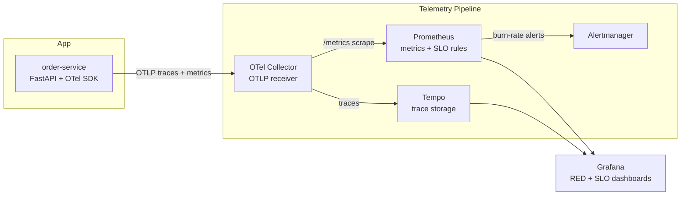

# Reliability & Observability Stack

An SLO-driven observability pipeline built around a FastAPI checkout service,
demonstrating instrumentation, telemetry pipeline design, and production-style
alerting -- not just dashboards.

## Why this project exists

Dashboards showing "requests went up" are easy. What's hard, and what this
project is actually about, is the reliability-engineering layer on top:
defining SLOs against real user journeys, turning them into recording rules,
and alerting on **error-budget burn rate** instead of raw thresholds -- the
same pattern used at companies running production SRE practices (Google,
and most large-scale platform teams).

## Architecture



**order-service** (`app/main.py`) simulates a checkout flow as three
sub-spans (`validate_payment` -> `reserve_inventory` -> `charge_card`), each
independently timed and independently failure-injectable, so traces show
real internal structure instead of one flat span. It exposes:
- OTLP traces -> the Collector
- Prometheus RED metrics (`http_requests_total`, `http_request_duration_seconds`,
  plus the business metric `checkout_value_total`)
- `/admin/chaos` -- dial error rate / latency at runtime to prove the
  alerting actually fires, not just that it's configured.

**OTel Collector** is the single ingestion point (`otel-collector/otel-collector-config.yaml`):
fans traces to Tempo, converts OTLP metrics into a Prometheus-scrapeable
endpoint. This mirrors how you'd front multiple services in a real org
instead of point-to-point exporters per service.

**Prometheus** evaluates two SLO recording-rule groups
(`prometheus/recording_rules.yml`): a rolling error ratio and a latency
breach ratio, each computed over 5m/30m/1h/6h/1d/3d windows.

**Alerting** (`prometheus/alerts.yml`) uses the **multi-window,
multi-burn-rate** method from the [Google SRE Workbook](https://sre.google/workbook/alerting-on-slos/):
an alert only pages when *both* a short window and a long window exceed the
burn-rate threshold together. This cuts single-spike false pages while still
catching real incidents in minutes, not hours.

## SLOs defined

| SLI | Objective | Error budget (30d) |
|---|---|---|
| Availability | 99.9% of `/checkout` requests succeed | 43m 49s |
| Latency | 99% of `/checkout` requests complete in < 300ms | 1% of requests |

| Alert | Burn rate | Window pair | Budget exhausted in | Severity |
|---|---|---|---|---|
| Fast burn | 14.4x | 5m & 1h | ~2 days | page |
| Mid burn | 6x | 30m & 6h | ~5 days | page |
| Slow burn | 1x | 1d & 3d | ~30 days | ticket |

## Dashboards

- **RED Metrics** (`grafana/dashboards/red-metrics.json`) -- request rate,
  error ratio, p50/p95/p99 latency, checkout value throughput, errors broken
  out by failing stage.
- **SLO & Error Budget** (`grafana/dashboards/slo-error-budget.json`) --
  live availability against the 99.9% objective, multi-window burn rate
  overlaid with the paging thresholds, and an active-alerts table.

Trace <-> metrics correlation is wired via exemplars (`datasources.yml`), so
a latency spike on the RED dashboard links straight to the Tempo trace that
caused it.

## Running it

```bash
docker compose up --build
```

| Service | URL |
|---|---|
| order-service | http://localhost:8000 |
| Grafana | http://localhost:3000 (anonymous admin access) |
| Prometheus | http://localhost:9090 |
| Alertmanager | http://localhost:9093 |
| Tempo query API | http://localhost:3200 |

Generate traffic and prove the alerting works end to end:

```bash
cd loadtest
pip install requests
python drive_traffic.py --warmup 60 --chaos 180 --rate 0.35
```

This runs 60s of healthy baseline traffic, then injects a 35% error rate for
3 minutes. Watch:
1. Error ratio climb on the RED dashboard
2. `CheckoutAvailabilitySLOFastBurn` fire in Prometheus (Alerts tab) within ~2 minutes
3. The alert route to Alertmanager (http://localhost:9093)
4. Everything clear once the script reverts to baseline

## What this demonstrates

- Instrumenting a service with OpenTelemetry (auto + manual spans) rather
  than just bolting on a metrics library
- Designing a telemetry pipeline through a Collector instead of
  service -> backend point-to-point wiring
- Translating business requirements into SLIs/SLOs and recording rules,
  not just graphing raw counters
- Multi-window, multi-burn-rate alerting to balance detection speed against
  alert fatigue -- the actual hard problem in on-call design
- Dashboards built around error budgets, matching how reliability is
  reported at the org level, not just per-service vanity metrics

## Extending it

- Add a Loki + Promtail leg for log correlation alongside traces/metrics
  (full LGTM stack)
- Swap the webhook receivers in `alertmanager.yml` for real PagerDuty/Slack
  integrations
- Add a second downstream service to show distributed traces spanning
  multiple hops
- Push `recording_rules.yml` burn-rate logic into a Terraform-managed
  Grafana Cloud / Amazon Managed Prometheus setup for a "how I'd run this
  in production" talking point in interviews
